

  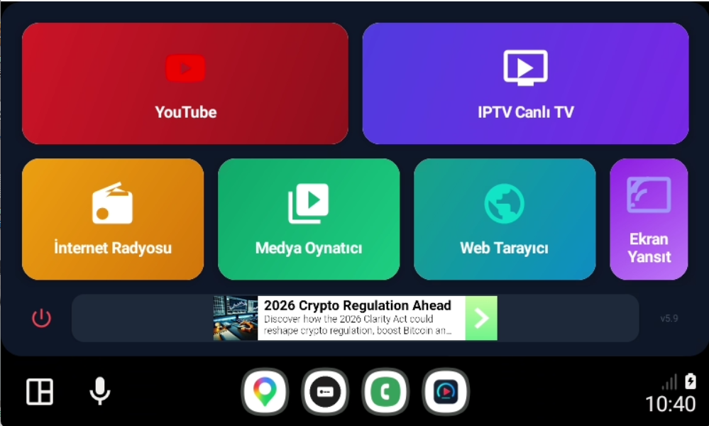

  
<em>İletişim, Destek ve Demo Videoları</em> 
  
    ;
  

# 🚗 Android Auto Lite TR (AALITE) - Ultimate Android Auto Entertainment & Multimedia Hub (No Root)

---

# 🇹🇷 TÜRKÇE DOKÜMANTASYON (TURKISH)

**Android Auto Lite TR**, Android Auto platformunun (Car App Library) katı kısıtlamalarını yıkarak; aracınızın bilgi-eğlence ekranını (Head Unit) tam teşekküllü bir multimedya merkezine dönüştüren, **Root gerektirmeyen (No Root required)**, üst düzey mimariye sahip kapalı kaynak (closed-source) bir uygulamadır.

IPTV Player, Web Browser, YouTube for Android Auto, Screen Mirroring (Ekran Yansıtma), Global Internet Radio ve yepyeni **Local Media Player (USB/Telefon)** özelliklerini tek bir çatı altında toplayan Android Auto Lite; özellikle **Direksiyon Kumandası Entegrasyonu**, **Uzak Cep Telefonu Yönetimi** ve **Kendi Geliştirdiğimiz Araç İçi Ekran Klavyesi** ile sürücülere rakipsiz, eller serbest (hands-free) bir deneyim sunar.

---

## 📥 Kurulum ve Sürüm Uyumluluk Rehberi (Installation & Compatibility)

Android Auto Lite TR uygulamasını Google'ın 3. parti uygulama kısıtlamalarına takılmadan aracınızda görüntüleyebilmek için kurulumun **[KingInstaller](https://github.com/fcaronte/KingInstaller)** üzerinden yapılması zorunludur. Uygulamanın en güncel `.apk` dosyasını GitHub deponuzun **Releases** bölümünden indirebilirsiniz.

### 📱 Android Sürümlerine Göre Kurulum Tablosu

| Android Sürümü | Kurulum Yöntemi & Uyumluluk Durumu |
| :--- | :--- |
| **Android 9.0 - 13.0** | ✅ **Tam Uyumlu:** [KingInstaller](https://github.com/fcaronte/KingInstaller) kullanılarak hiçbir sorun yaşanmadan, tek tıkla kolayca kurulabilir. |
| **Android 14.0 - 15.0** | ⚠️ **Kısmi Uyumlu:** Cihaz marka, model ve OEM arayüz güvenlik kısıtlamalarına bağlı olarak bazı cihazlarda istisnai durumlar veya kurulum engelleri yaşanabilir. |
| **Android 16.0** | 🔒 **Özel Test Aşamasında:** KingInstaller desteklememektedir! Android 16 için yalnızca Google Play kapalı test altyapısı üzerinden yükleme yapılabilmektedir. |

> 📌 **Kurulum İpucu:** `KingInstaller` uygulamasını yükledikten sonra, indirdiğiniz `Android Auto Lite TR .apk` dosyasını KingInstaller içerisinden seçin ve **"Install as King"** butonuna basarak yüklemeyi tamamlayın.
> 
> 📺 **Video Rehberler:** Kurulum detayları, direksiyon kumandası testleri ve arayüz demoları için [AutoLiteTR YouTube Kanalımızı](https://www.youtube.com/@AutoLiteTr) inceleyebilirsiniz.

---

## 🌟 Öne Çıkan Özellikler ve Teknik Mimari (Core Features)

### 📱 Telefondan Anlık ve Detaylı Yönetim (Real-Time Configuration)
Araçtayken ekrana dokunup ayar aramakla uğraşmayın! Android Auto Lite, son derece gelişmiş bir **Mobil Uygulama Kontrol Paneli** sunar. Cep telefonunuzdan yaptığınız bir değişiklik; `OnSharedPreferenceChangeListener` mimarisi sayesinde **milisaniyeler içinde araç ekranındaki görüntüye yansır**.

  <table>
    <tr>
      <td align="center" valign="middle"><b>📱 Telefondan Yönetim Menüsü</b> 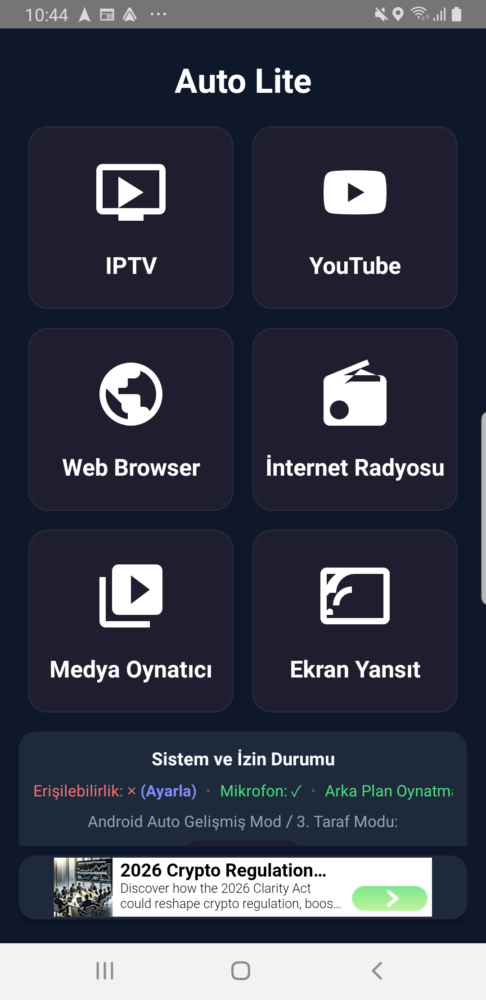</td>
      <td align="center" valign="middle"><b>🚗 Araç Ekranına Anlık Yansıma</b> </td>
    </tr>
  </table>

---

### 🛞 Tam Direksiyon Kumandası Entegrasyonu (Steering Wheel Controls)
Sürüş güvenliğini bozmadan maksimum kontrol! Uygulamamız, aracınızın donanımsal medya tuşlarıyla kusursuz konuşmak için `MediaSessionCompat` API'lerini doğrudan kullanır.
* **YouTube Entegrasyonu:** Direksiyon kumandanız YouTube izlerken de aktif! İleri/geri tuşlarıyla YouTube'da doğrudan **sonraki veya önceki videoya** geçiş yapabilir, videoları durdurup başlatabilirsiniz.
* **Tüm Modüllerde Akıllı Zapping (IPTV, Radyo & Yerel Medya):** Direksiyondaki tuşlarla binlerce M3U kanalı, internet radyosu istasyonları veya USB belleğinizdeki müzikler arasında gözünüzü yoldan ayırmadan, saniyeler içinde muazzam bir rahatlıkla geçiş (zapping) yapın.

---

### 🎵 YENİ! Yerel Medya Motoru (USB & Telefon Hafızası)
Araç USB belleğinize taktığınız müzik ve videoları yüksek hızda listeler. `RecyclerView` mimarisi sayesinde binlerce şarkı gecikme yaşatmaz.
* **Gerçek Zamanlı Arama:** Arama kutusu ile yazarken anında filtreleme. Müziklerinize anında ulaşın.
* **Görsel Spektrum:** Şık animasyonlu barlar eşliğinde müzik dinletisi.

  <table>
    <tr>
      <td align="center" valign="middle"><b>🎵 Yerel Medya Oynatıcı</b> 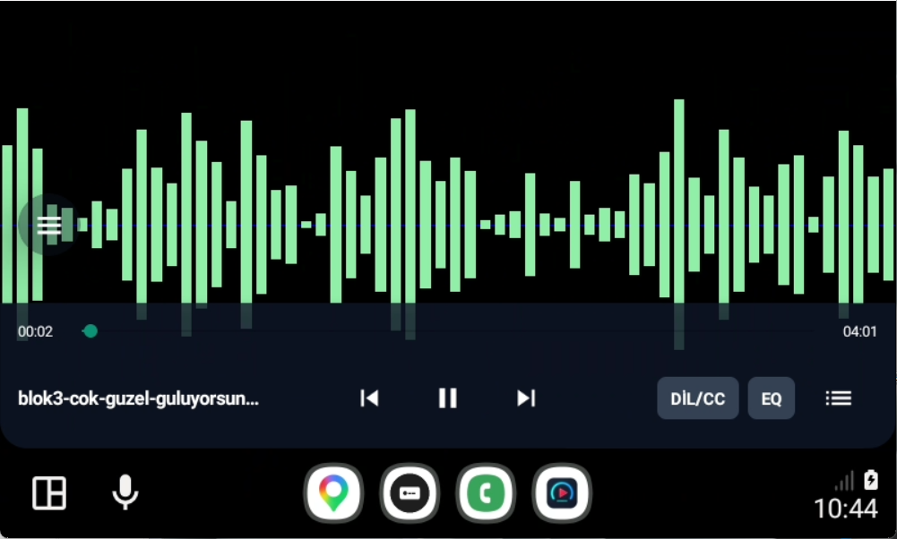</td>
      <td align="center" valign="middle"><b>📱 Medya Ayarları</b> 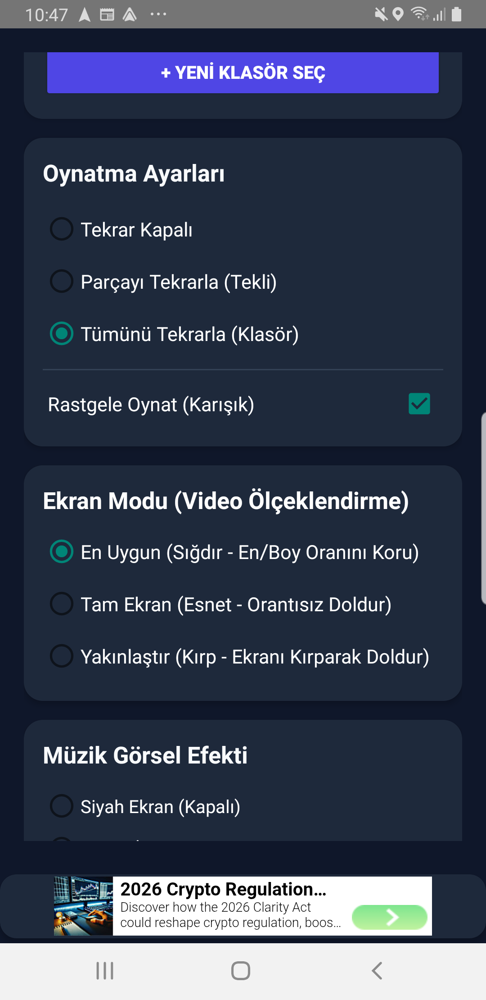</td>
    </tr>
  </table>

---

### 📺 Gelişmiş Canlı TV Motoru (Advanced IPTV Player)
ExoPlayer donanım ivmelendirmesi ile güçlendirilmiş, takılmasız canlı TV deneyimi. Binlerce kanallık M3U listelerini saniyeler içinde parse eder.

  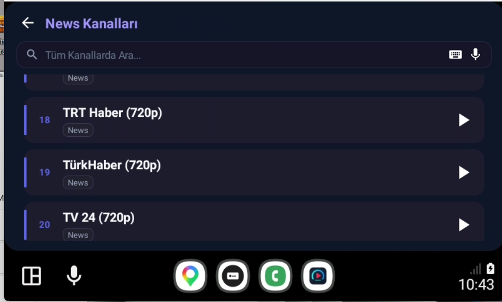
  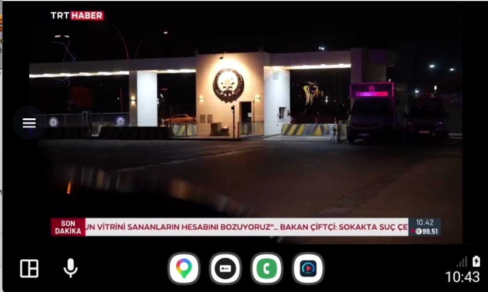

---

### 📻 Akıllı Radyo & 🔊 Evrensel Ses Yönetimi (Universal Audio Focus)
Dünyanın her yerinden binlerce radyoya erişin ve ses çakışmalarını unutun!
* **Universal Audio Focus:** Yeni geliştirdiğimiz sistemle Android Auto'nun `CarAudioManager` donanımına tam entegre olduk. YouTube, IPTV, Radyo veya USB Müzik... Birini açtığınızda diğerleri akıllıca susturulur veya duraklatılır! Ses çakışmasına son.
* **Dinamik Ses Spektrumu (Visualizer):** Müziğin ritmine göre hareket eden, donanım ivmeli görsel animasyonlar.

  <table>
    <tr>
      <td align="center" valign="middle"><b>📻 Radyo Visualizer</b> 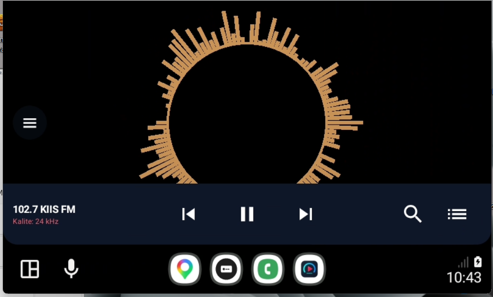</td>
      <td align="center" valign="middle"><b>📱 Radyo Ayarları</b> 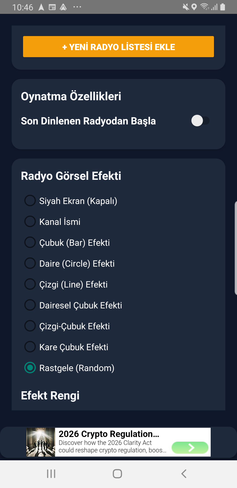</td>
    </tr>
  </table>

---

### ⌨️ Özel Araç İçi Ekran Klavyesi (Custom On-Screen Keyboard)
Google'ın Android Auto üzerindeki 3. parti uygulamalara uyguladığı "klavye açılamaz" (No Keyboard Support) limitini tamamen hack-free bir yöntemle aştık! Akıllı ve dev ekran klavyemiz kendi UI katmanında (Canvas) özel olarak render edilir.

  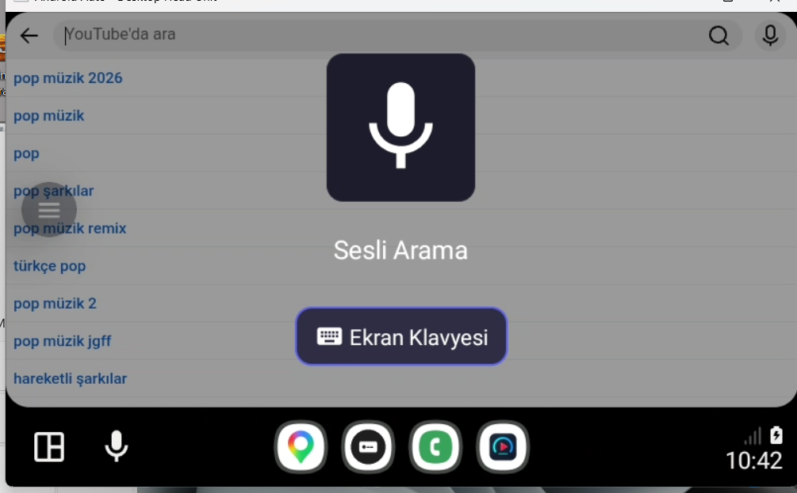
  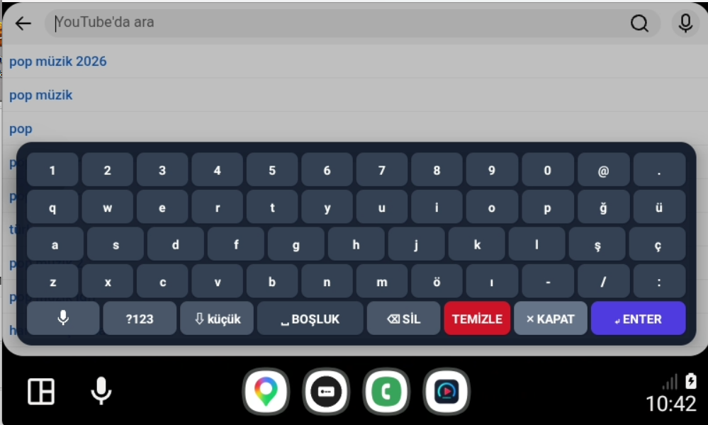

---

### 🌐 Reklam Engelleyicili Tarayıcı ve YouTube (AdBlock & Web Browser)
* **Sıfır Reklam:** Özel JS Injection (AdBlocker Script) stratejisi sayesinde YouTube veya web sitelerindeki sponsorlu içerikler ve reklamlar anında engellenir.
* **Kusursuz Görüntü (Anti-Aliasing):** Tüm arayüzdeki ikonlar (Geri tuşu, Arama vs.) modern `AppCompatImageView` vektör motoruna taşınarak her ekranda pürüzsüz cam gibi görünmesi sağlandı.

  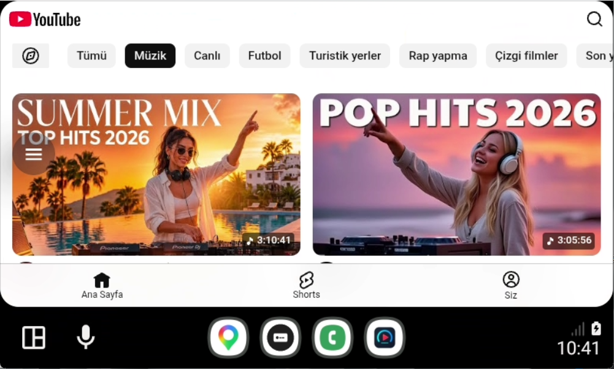
  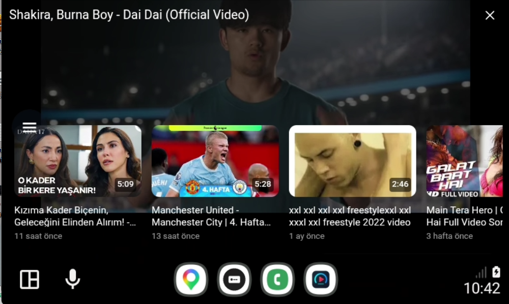

  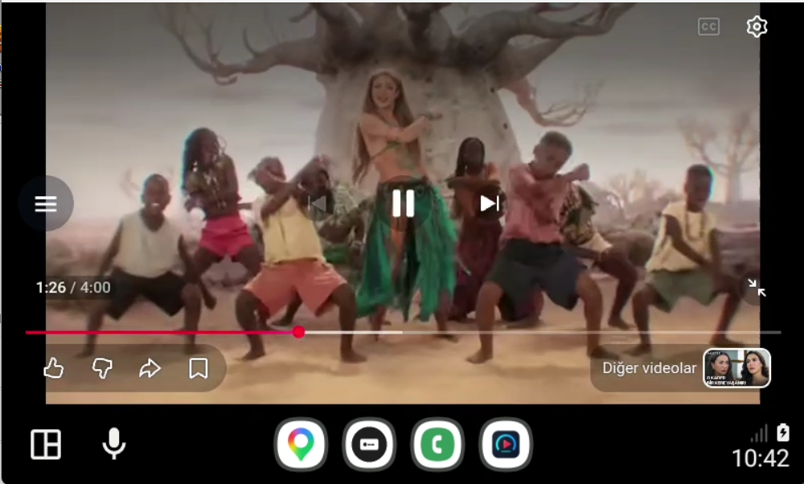
  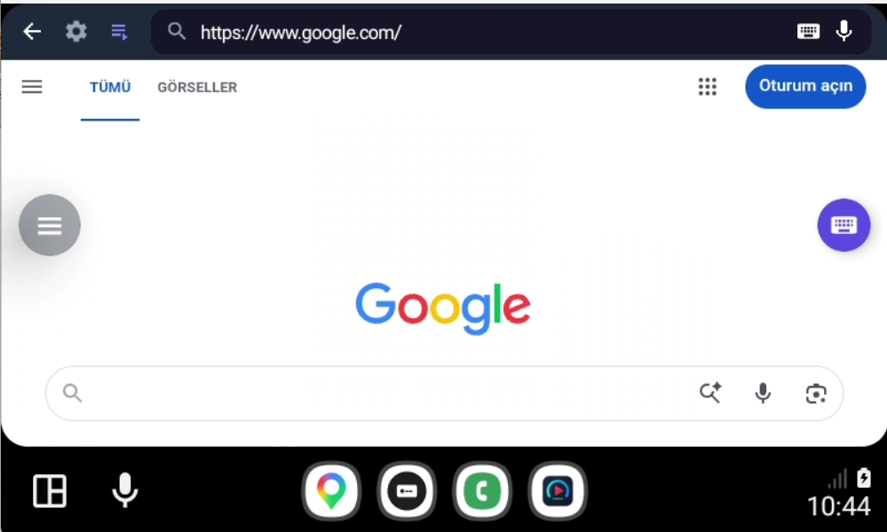

---

## 🏷️ Size Özel Beyaz Etiket Çözümleri (White-Label Solutions)
Geliştirdiğimiz bu devasa altyapıyı sizin markanıza özel hale getirebiliriz:
* **Sizin Markanız:** Sizin belirleyeceğiniz özel uygulama adı ve logolar.
* **Size Özel Altyapı:** Tamamen size ait benzersiz `com.sirketiniz.uygulamaadi` paket adı.
* **Üst Düzey Güvenlik:** Kırılamaz özel şifreleme (Obfuscation / ProGuard) ile kod koruması.
* **Bağımsız Kazanç:** Uygulamayı doğrudan kendi **Google Play Developer** hesabınıza yükleyip tüm gelir modelini kendiniz yönetebileceğiniz hazır ve imzalı `.aab` paketleri.

Bu iş fırsatını değerlendirmek ve kendi Android Auto projenizi başlatmak için detayları görüşmek üzere iletişim kurabilirsiniz.

   
---
---
---
   

# 🇺🇸 İNGİLİZCE DOKÜMANTASYON (ENGLISH)

# 🚗 Android Auto Lite TR - Ultimate Android Auto Entertainment & Multimedia Hub (No Root)

**Android Auto Lite TR** is a closed-source application featuring a high-end architecture that breaks down the strict limitations of the Android Auto platform (Car App Library). It transforms your vehicle's infotainment screen (Head Unit) into a fully-fledged multimedia hub **without requiring any Root access (No Root required)**.

Bringing together an IPTV Player, Web Browser, YouTube for Android Auto, Screen Mirroring, Global Internet Radio, and our brand new **Local Media Player (USB/Phone)** under a single roof, Android Auto Lite offers drivers an unrivaled, hands-free experience—especially through its **Steering Wheel Controls Integration**, **Remote Phone Configuration**, and our proprietary **Custom Android Auto OSK (On-Screen Keyboard)**.

---

## 📥 Installation & Version Compatibility Guide

To bypass Google's 3rd-party app restrictions on Android Auto and display Android Auto Lite TR on your vehicle's head unit, installation must be performed via **[KingInstaller](https://github.com/fcaronte/KingInstaller)**. You can download the latest `.apk` release directly from our GitHub Releases section.

### 📱 OS Compatibility Matrix

| Android Version | Installation Method & Compatibility Status |
| :--- | :--- |
| **Android 9.0 - 13.0** | ✅ **Fully Compatible:** Seamless, one-click installation via [KingInstaller](https://github.com/fcaronte/KingInstaller) with zero issues. |
| **Android 14.0 - 15.0** | ⚠️ **Partially Compatible:** Installation stability may vary depending on device brand, model, and OEM software security restrictions. |
| **Android 16.0** | 🔒 **Closed Testing Only:** Not supported via KingInstaller! Installation for Android 16 is restricted strictly to Google Play Closed Testing infrastructure. |

> 📌 **Installation Tip:** After installing `KingInstaller`, select the downloaded `Android Auto Lite TR .apk` file from inside KingInstaller and click the **"Install as King"** button to complete the setup.
>
> 📺 **Video Guides:** For detailed installation tutorials, steering wheel control tests, and UI demos, please visit our [AutoLiteTR YouTube Channel](https://www.youtube.com/@AutoLiteTr).

---

## 🌟 Core Features & Technical Engineering

### 📱 Real-Time Phone Configuration
No more struggling to navigate settings by touching the vehicle screen while on the road! Android Auto Lite offers a highly advanced **Mobile App Control Panel**. The moment you change a setting on your smartphone, the **image on the vehicle screen updates within milliseconds** thanks to our `OnSharedPreferenceChangeListener` architecture.

### 🛞 Advanced Steering Wheel Controls
Maximum control without compromising driving safety! Our application directly utilizes `MediaSessionCompat` and Android Auto hardware APIs to communicate flawlessly with your vehicle's physical media buttons.
* **YouTube Integration:** Your steering wheel controls remain active while watching YouTube! Easily skip directly to the **next or previous video**, play, and pause simply by pressing the physical buttons on your steering wheel.
* **Seamless Zapping across All Modules:** Switch effortlessly between thousands of IPTV channels, global web radio stations, or your Local Media (USB) tracks in seconds using your steering wheel controls—without ever taking your eyes off the road.

### 🎵 NEW! Local Media Engine (USB & Phone Storage)
Instantly loads music and videos stored on your car's USB drive or phone memory. Thanks to our new `RecyclerView` architecture, scrolling through thousands of files is lag-free.
* **Real-Time Search:** Type using the OSK and instantly filter results.
* **Visual Spectrum:** Enjoy your offline music with stylish visual equalizer bars.

### 📺 Advanced IPTV Player & M3U Parser
A stutter-free live TV experience powered by ExoPlayer Hardware Acceleration. Parses M3U playlists with thousands of channels in mere seconds.

### 📻 Intelligent Web Radio & 🔊 Universal Audio Focus
* **Universal Audio Focus System:** Fully integrated with Android Auto's `CarAudioManager`. Say goodbye to overlapping audio! Whether you launch YouTube, IPTV, Radio, or Local Media, the system intelligently pauses or stops the background audio source.
* **Dynamic Audio Visualizer:** Hardware-accelerated visual animations that move to the rhythm of the music.

### ⌨️ Custom In-Car On-Screen Keyboard
We bypassed Google's "No Keyboard Support" restriction imposed on 3rd-party apps on Android Auto using a completely hack-free method! Android Auto Lite features an intelligent touch keyboard specially rendered on its own UI layer (Canvas).

### 🌐 AdBlock YouTube & Web Browser
* **Zero Ads:** Thanks to our proprietary JS Injection (AdBlocker Script) strategy, sponsored content and advertisements on YouTube or websites are blocked instantly before you even see them.
* **Flawless Vector Rendering (Anti-Aliasing):** All UI icons (such as Back or Search buttons) have been upgraded to `AppCompatImageView` to prevent pixelation, ensuring crystal-clear visuals on all head unit screens.

---

## 🏷️ Tailored White-Label Solutions
We can customize this massive infrastructure specifically for your brand:
* **Your Brand:** Custom application name and logos determined by you.
* **Dedicated Infrastructure:** A unique package name (`com.yourcompany.appname`) belonging entirely to you.
* **High-End Security:** Code protection with unbreakable, advanced encryption (Obfuscation / ProGuard).
* **Independent Revenue:** Ready-to-deploy, signed `.aab` packages that you can directly upload to your own **Google Play Developer** account.

Feel free to get in touch to discuss details, evaluate this business opportunity, and launch your own Android Auto project.

---
*This robust Android Auto application is designed to push the limits of Car App Development, bypassing generic OEM restrictions to deliver a true in-car entertainment system. Includes complex implementations of ExoPlayer, WebView JS Injection, MediaSessionCompat, Universal Audio Focus and SharedPreferences synchronization. (Closed-Source)*
